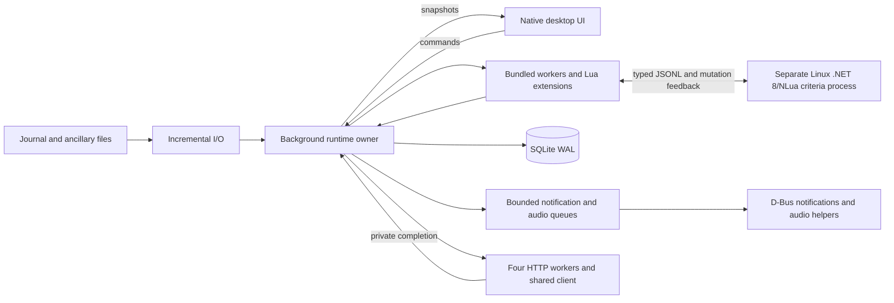

# Native architecture

The native executable is a Rust application. It reads Linux files directly, renders eframe/egui windows using X11 or Wayland, and stores findings and plugin vaults in SQLite. StellarOverlay owns native transparent notification/radar windows; D-Bus notifications remain available as a fallback. Core and all four requested installed-plugin workers remain Rust. Original Explorer criteria use a separate bundled .NET 8/NLua process; neither the main application nor those workers wrap the old managed desktop or launch it through Wine.

## Workspace boundaries

| Crate | Responsibility | Dependencies on other local crates |
| --- | --- | --- |
| `observatory-domain` | Lossless journal envelope and common finding record. Event payloads retain unknown properties and event names; integer system addresses remain `u64`. | None |
| `observatory-io` | XDG configuration, Steam/Proton/Wine/Lutris path discovery, incremental journal cursors, ancillary files, replay and cancellation. | Domain |
| `observatory-plugins` | Native Explorer, Botanist and Communicator workers; original-format Explorer criteria adapter and managed-runtime client. | Domain |
| `observatory-desktop` | CLI and desktop entry points, runtime ownership, commands/snapshots, persistence, export, native notifications/audio, shared HTTP and extension host. | Domain, I/O, plugins |

The I/O crate exposes synchronous incremental operations so the application can put them on one existing worker. A single owner is preferable to independent filesystem callbacks mutating worker histories: journal ordering, body history, duplicate suppression and cancellation all depend on consistent state transitions. Adding an async runtime would not itself improve those contracts.

## Ownership, ordering and persistence

The controller sends commands to a named journal worker thread. That thread owns the tailer, all bundled worker histories, extension instances and its SQLite connection. It processes journal events serially in deterministic file order. The UI reads a mutex-protected snapshot and sends commands; it does not execute journal parsing, SQLite queries or Lua callbacks while drawing a table.

Large worker views and rows are immutable `Arc` projections. Independent dirty
flags rebuild only the affected views, outside the UI snapshot lock. Movement
updates sampler/radar state without rebuilding BioInsights' catalogue or tables.
Projection replacement holds the lock briefly; old values are retired outside
it. BioInsights also caches source themes and column measurements, skips painting
offscreen species, and uses bounded background workers for images and region maps.

`JournalTailer` keeps a cursor for every observed journal rather than assuming that only the newest file can change. It detects truncation and replacement, retains incomplete UTF-8/JSON lines until they finish, and reads old and new journal naming formats in chronological order. Each live poll consumes at most 512 records or 4 MiB of input, preserving the cursor for subsequent polls. Individual records over 16 MiB are reported and skipped; subsequent valid lines recover. Status and other ancillary JSON files are independent snapshots rather than journal events. The engine applies valid ancillary updates before same-poll journal events so an organic sample captures the newest available surface position.

The database uses SQLite WAL mode and `synchronous=NORMAL`. A unique constraint on the exact `(plugin, timestamp, system, body, title, detail)` tuple makes repeated replay idempotent for the same finding content. This is content deduplication, not a transactional coupling between game file offsets and the database. File cursors are reconstructed on startup. Worker state is rebuilt from current context or replay, while persistent findings survive application restart.

The visible findings history is capped at 10,000 entries, errors at 100, and extension table rows at 10,000. The database retains complete finding history until the user manages the data file; the UI cap is not a database retention policy. Configuration replacement uses a temporary file in the destination directory followed by atomic persistence.

The same journal thread owns BioInsights, Evaluator, Hecate and StellarOverlay.
Original command envelopes connect the biological/exploration ledgers and radar.
Native fan-out is processed in 256-message slices; remaining messages resume on
the next worker poll, with a 32,768-message pending cap. Analytical BioInsights
flags and vault mutations remain enabled during replay; presentation messages
are suppressed. Hecate's four databases retain original schema/Zstd contracts.
BioInsights marks, personal Codex and validated public Galactic Codex cache use
an atomic versioned snapshot. Native HTTP origins have reserved colon-prefixed
IDs, separate from Lua's permitted ID alphabet.

Settings replacement flushes Hecate and releases its optional listener before
opening the replacement engine. A failed configuration save restores the old
listener; successful settings are saved after old-plugin shutdown callbacks.
Disabled Hecate neither starts its web server nor rebuilds its existing vault.
The optional HTTP/WebSocket bridge uses bounded connection and response queues
and dispatches original requests to the same native plugin state as the UI.

## Replay, stop and errors

- First monitor startup prereads current-system context in batch mode. Existing unrelated historical files are primed, so they are not mistaken for fresh live events.
- Read-all resets bundled worker histories, streams journal events through the same engine, and suppresses ordinary live notifications while batch mode is active. Persisted findings are deduplicated rather than deleted.
- Stop and shutdown set an atomic cancellation token before their command is consumed. Replay and incremental reading check it between records. Cancellation preserves the cursor at the last delivered record; untouched history is not imported later as live activity.
- A malformed journal record produces a file/line diagnostic and later records can continue. An invalid or partially replaced ancillary JSON snapshot does not overwrite the last valid status.
- Invalid replacement settings are prepared before the runtime swaps to them. Failure leaves the previous engine available and records an error.
- Notification and audio dispatch use bounded queues off the journal thread. Missing desktop/audio services and queue overflow are visible errors. Audio helper processes have a timeout; playback does not block the UI thread.
- Plugin HTTP requests are staged transactionally, then submitted to a shared reqwest client through four workers and a 64-entry queue. Deadlines include queue time and body reading, are capped at ten seconds, and response bodies are limited to 4 MiB. Completions return to the serial engine and only the originating active plugin generation; unloading discards pending results. Network I/O never runs inside a Lua callback.

These are cooperative application guarantees. Disk failures and process termination can interrupt work; the SQLite and configuration choices limit the amount of mutable state involved in recovery.

## Native extension contract

Bundled workers are ordinary Rust types. User extensions are separate Lua instances with host-provided journal/status/cargo callbacks, settings, namespaced storage, findings, table rows, messages, asynchronous HTTP, export and notification lifecycle operations. Plugin source returns a metadata/handler table. The host initializes all metadata and settings before `on_load`, calls ready/state/shutdown hooks, and can reload plugins without restarting the process.

Each extension has a 32 MiB Lua allocation limit. A global Lua hook checks a 100 ms callback budget and five million instructions, including coroutines. Source is capped at 4 MiB, stored JSON state at 1 MiB, individual returned values at 256 KiB and callback output at 4 MiB/10,000 items. Direct `io`, `os`, `package`, `require`, `dofile`, `loadfile` and debug access are removed. These are in-process limits rather than operating-system process isolation; hooks run at Lua instruction boundaries.

Callbacks stage host-visible output and storage changes. A failing callback discards that callback's changes and disables its instance, while earlier successful output is retained. Messages carry source metadata and use bounded delivery; errors identify the plugin. Plugin notification IDs are namespaced, with host routing for show/update/cancel and audio/popup overrides. The host controls the UI and filesystem services rather than exposing native widget pointers.

Explorer custom criteria are a separate compatibility surface from native extension plugins. A persistent JSONL child runs the linked original `CustomCriteriaManager`, real NLua 1.7.3 and the full source-built Framework API on self-contained .NET 8.0.33. It provides actual `LoadCLRPackage`, reflection, collections, constructors, events and Framework methods. Its complete runtime ships under `lib/observatory-core/clr` (about 72 MiB unpacked). [Source provenance and verification](CLR_SCRIPT_PARITY.md).

Rust owns native histories and supplies typed snapshots with original dictionary keys and exact `JournalBase.Json`. The child preserves CLR object identities, returns changed scan/signal objects and the separately mutable `Scan.Parent` projection, and Rust applies those updates before later built-in criteria. Result formatting uses the mutated current event. Idle polling collects asynchronous CLR callbacks and history mutations without dispatching a journal. Cache pruning follows native history retention while Lua-held references remain valid.

The protocol reserves private stdin/stdout descriptors; normal Lua/CLR input returns EOF and script output goes to stderr. Frames are capped at 64 MiB and the parent bounds each request to ten seconds by default. A timed-out or exited child is stopped and reported once; the parent does not automatically restart it or replay script side effects. Trusted criteria retain ordinary CLR filesystem/assembly authority rather than the restricted native-extension Lua API.

## Compatibility boundaries and acceptance

The Rust desktop does not provide the original Windows EOP/WinForms plugin ABI. Criteria may load compatible managed assemblies through NLua; Windows-only libraries retain normal Linux .NET limitations. Other binary desktop plugins and custom Windows controls need a native implementation or migration to the documented extension API.

The desktop implements saved color palettes, resizable naturally sorted tables, tab order, independently filtered plugin popouts with saved geometry, and installed voice/audio-output selection. State tests and real X11/Wayland rendering validate those paths. Core and StellarOverlay provide native passive surfaces; D-Bus fallback presentation follows the notification server's policy. External WinForms views and comparer objects need native adaptation. Private synthetic fullscreen and PulseAudio null-sink acceptance is recorded in [its receipt](fixtures/private-fullscreen-audio-linux-qa.json). Actual Linux/Proton gameplay was unavailable, and physical audio listening and clean-distribution installation remain unperformed acceptance checks.
